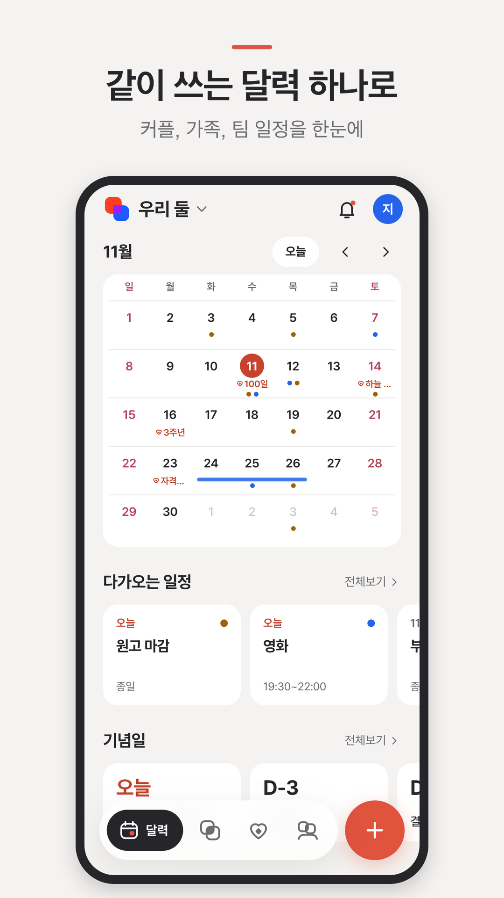
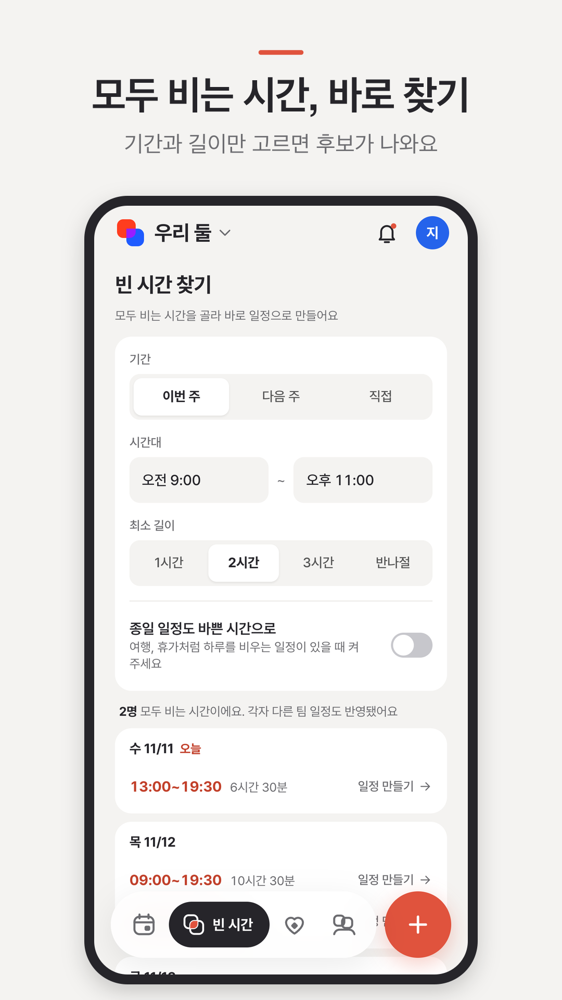
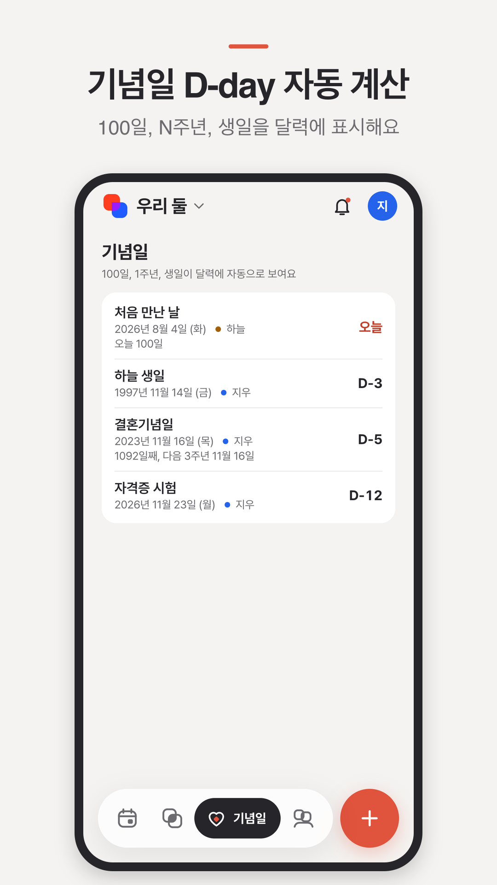
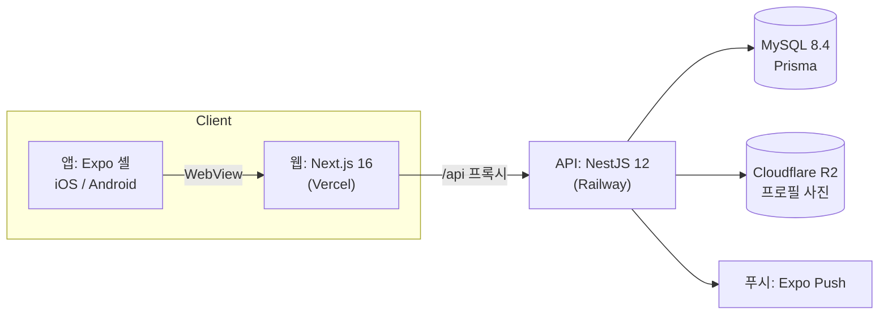

<div align="center">


### 같이 쓰는 달력 하나로, "언제 볼까?"를 바로

커플, 가족, 친구, 작은 팀이 달력 하나를 같이 쓰고<br/>
다 같이 비는 시간을 한눈에 찾는 공유 일정 서비스

[**whenwemeet.day**](https://whenwemeet.day) &nbsp;|&nbsp; [App Store](https://apps.apple.com/kr/app/id6832865813) &nbsp;|&nbsp; Google Play (비공개 테스트 중)

<br/>





</div>

<br/>

## 무엇을 하나요

| | |
|---|---|
| 📅 **같이 쓰는 달력** | 팀마다 달력 하나. 월 보기, 주 보기(시간 격자), 일 상세. 일정마다 참여자와 색 |
| 🕐 **다 같이 비는 시간** | 멤버 모두 비는 시간을 계산해 보여 줘요. 약속 잡는 시간이 줄어요 |
| 💝 **기념일 D-day** | 처음 만난 날 100일, 1주년, 생일. 다가오는 날을 미리 알려 줘요 |
| ✅ **같이 쓰는 할 일** | 장보기, 여행 준비물처럼 팀이 같이 채우는 목록 |
| 🔔 **알림과 새 소식** | 일정 알림, 주간 요약, 팀원이 바꾼 일정 소식 |
| 🔗 **초대와 공유** | 링크나 6자리 코드로 초대, 일정 카드를 카카오톡으로 공유 |
| 📲 **어디서나** | 모바일 웹, iOS, Android 앱. 홈 화면 위젯, 다른 캘린더 앱 연결(ICS) |

## 구조



| 영역 | 경로 | 기술 |
|------|------|------|
| 웹 | `apps/web` | Next.js 16 (App Router), React 19, Tailwind 4 |
| API | `apps/api` | NestJS 12, Prisma, MySQL 8.4, `/v1` |
| 앱 | `apps/mobile` | Expo SDK 58 셸 (웹뷰 + 카카오, Apple 네이티브 로그인, 푸시, 위젯). 빌드는 [docs/운영/앱-빌드.md](docs/운영/앱-빌드.md) |
| 로그인 | | 카카오, Apple, 이메일 6자리 코드 |

작업 규칙과 진행 방식은 [CLAUDE.md](./CLAUDE.md), 역할별 지침은 [agents/](./agents), 설계 문서는 [docs/설계](docs/설계)에 있어요.

<br/>

## 개발 환경

### 준비물

| 항목 | 버전 | 비고 |
|------|------|------|
| Node.js | 24 | `nvm use 24` |
| pnpm | 9.12.3 | `corepack enable` 또는 `npm i -g pnpm@9.12.3` |
| MySQL | 8.4 | Docker 또는 로컬 설치 중 하나 (아래 A / B) |

### 실행

#### 1. 환경 파일 복사

```bash
cp .env.example .env                              # docker compose 용 (B 경로면 생략 가능)
cp apps/api/.env.example apps/api/.env            # 백엔드
cp apps/web/.env.example apps/web/.env.local      # 프론트
```

`apps/api/.env` 의 `KAKAO_*` 는 [docs/운영/카카오-개발자센터.md](docs/운영/카카오-개발자센터.md) 대로 앱을 등록한 뒤 채운다. `JWT_SECRET` 은 `openssl rand -base64 48` 로 만든 값으로 바꾼다.

#### 2-A. MySQL — docker compose

```bash
docker compose up -d          # mysql:8.4, 호스트 포트 3307 (루트 .env 의 MYSQL_PORT)
docker compose ps             # STATUS 가 healthy 가 될 때까지 몇 초 대기
```

- 첫 기동 시 `docker/mysql/init/01-test-db.sh` 가 테스트 DB `whenwemeet_test` 를 만들고 앱 계정에 권한을 준다.
- `apps/api/.env` 의 `DATABASE_URL` / `TEST_DATABASE_URL` 기본값이 이 구성과 맞춰져 있으므로 그대로 두면 된다.
- 초기화 스크립트를 다시 돌리려면 `docker compose down -v` (데이터 삭제) 후 재기동.

#### 2-B. MySQL — 로컬 Homebrew MySQL 사용

Docker 없이 로컬에 MySQL 이 이미 떠 있으면(예: `brew services start mysql`, 포트 3306) compose 를 올리지 않고 DB 두 개만 만든다.

```bash
mysql -uroot -p -e "CREATE DATABASE IF NOT EXISTS whenwemeet      CHARACTER SET utf8mb4 COLLATE utf8mb4_0900_ai_ci;
                    CREATE DATABASE IF NOT EXISTS whenwemeet_test CHARACTER SET utf8mb4 COLLATE utf8mb4_0900_ai_ci;"
```

그다음 `apps/api/.env` 의 DB 두 줄만 로컬 접속 정보로 바꾼다. `<비밀번호>` 자리에 로컬 root(또는 전용 계정) 비밀번호를 넣고, 비밀번호가 없으면 `root:@` 로 둔다.

```dotenv
DATABASE_URL="mysql://root:<비밀번호>@localhost:3306/whenwemeet"
TEST_DATABASE_URL="mysql://root:<비밀번호>@localhost:3306/whenwemeet_test"
```

- 루트 `.env` 와 `docker-compose.yml` 은 이 경로에서 쓰이지 않는다.
- MySQL 9.x 도 동작하지만 CI 와 운영은 8.4 기준이다.

#### 3. 설치와 기동

```bash
pnpm install
pnpm dev        # web http://localhost:3000, api http://localhost:4000 동시 기동
```

백엔드 스키마가 들어온 뒤에는 첫 기동 전에 마이그레이션을 적용한다.

```bash
pnpm --filter @whenwemeet/api exec prisma migrate dev
```

## 외부 서비스 설정

- 카카오 개발자센터 앱 등록과 키 발급: [docs/운영/카카오-개발자센터.md](docs/운영/카카오-개발자센터.md)
- 프로필 사진 저장소(R2): [docs/운영/cloudflare-r2.md](docs/운영/cloudflare-r2.md)

## 배포

운영 배포 흐름, 환경 변수, 비용은 [docs/운영/배포.md](docs/운영/배포.md). 플랫폼별 설정은 [Railway (API + MySQL)](docs/운영/railway.md), [Vercel (웹)](docs/운영/vercel.md).

## CI

`.github/workflows/ci.yml` 이 PR 과 `main` push 마다 `lint`, `test`, `build` 를 돈다. 백엔드 테스트용으로 `mysql:8.4` 서비스 컨테이너가 붙고 `DATABASE_URL`, `TEST_DATABASE_URL` 이 그쪽을 가리킨다. `apps/api/prisma/schema.prisma` 가 있을 때만 `prisma generate` 를 실행한다.
