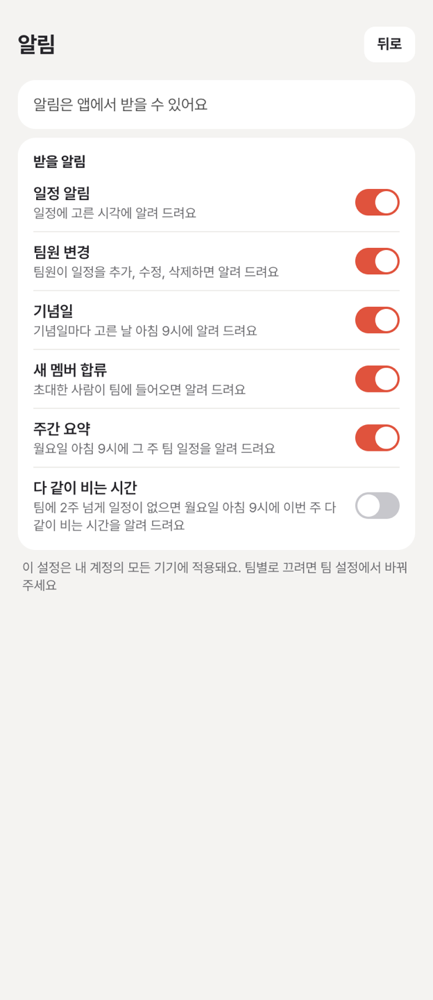
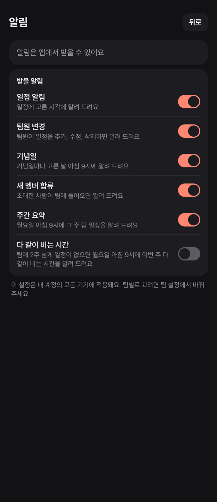
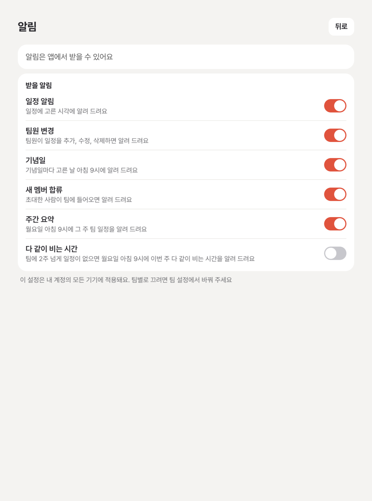
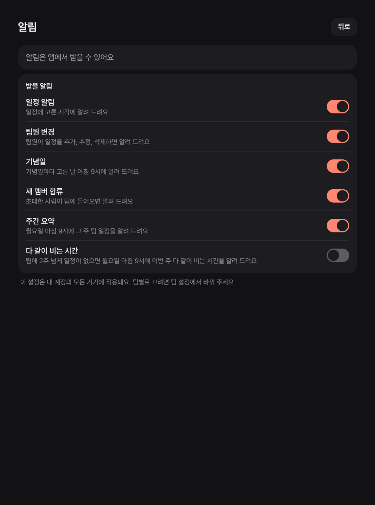
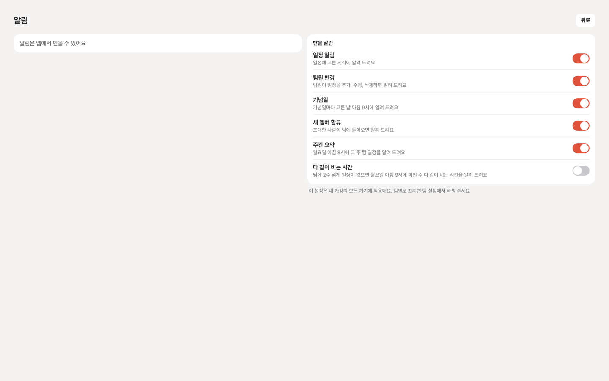
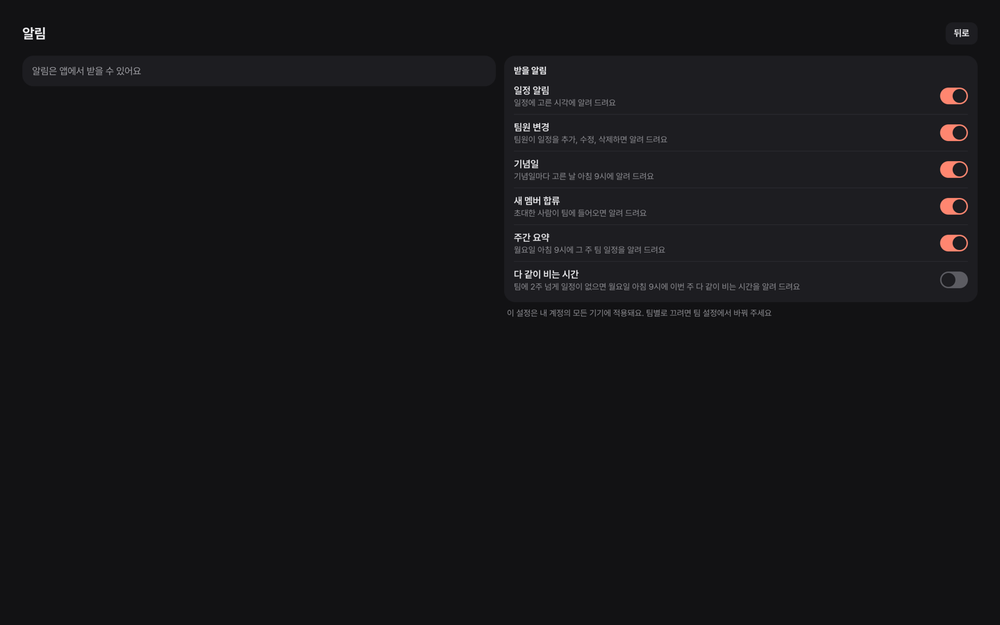

# QA 결과 2026-11-12 (#277 주간 요약과 조용한 팀 깨우기)

- 브랜치 `feat/277-weekly-push` (develop 29f7518 기준), 로컬 MySQL 3307 의 전용 DB `wwm_277`, `wwm_277_test`
- 결정: D-203 ~ D-205. 깨우기("다 같이 비는 시간")는 별도 토글, 기본 끔 (법률 확인 전, 주인 결정 2026-11-12)

## 자동 테스트
| 항목 | 결과 |
|------|------|
| API 단위 + e2e (`pnpm test:cov`) | 78 파일, 1121개 통과. 전체 문 커버리지 97.59%, `weekly-planner.ts`, `push-dispatcher.ts`, `push.repository.ts`, `push.scheduler.ts` 100%, `push-copy.ts` 100% (분기 98.68%) |
| `weekly-planner.spec.ts` (28) | 월요일 09:00 ~ 12:00 판정, 키와 흩뿌림, 회차 수 0/1/3, 여러 날, 반복 + 취소 회차 + 예외 제목, 기념일 꼬리, 깨우기 조건 표 10줄, 빈 시간(다른 팀, 참여자, 종일 제외), plan/build |
| `push-copy.spec.ts` 주간 문구 | SUMMARY 5줄(외 N개, 받침 이에요/예요), KST 요일, NUDGE(외 k개), 권유형 금지, Expo 메시지에 variant 없음 |
| `push-dispatcher.spec.ts` 주간 | 3시간 늦음 허용(2:59 펼침, 3:01 SKIPPED), 변형별 토글, 0명/판정 null CANCELLED, 재전송 3시간 |
| `weekly-push.e2e-spec.ts` (7, 가짜 시계) | 일요일 23:59 / 월요일 08:59 없음 → 09:00 예약 3건(팀 1 + 개인 2) → 09:10 팀 DISPATCHED, 두 사람 PushDelivery SENT, 개인 팀 CANCELLED. 다른 holder 로 09:30, 11:00 (weekly 행 삭제 포함) 재시작해도 1건. 11:50 복귀 보냄, 12:10 복귀 그 주 없음. 요약 끔, 팀 알림 끔 제외, 예약 뒤 합류자 받음. 깨우기 기본 끔 CANCELLED, 켠 사람만 NUDGE, 4주 간격(0 보냄, 1~3 CANCELLED, 4 보냄), 90일 중단, 지난 14일 회차, 멤버 1명 |
| 웹 `pnpm test` | 50 파일 609개 통과 (새 `NotificationSettingsScreen.test.tsx`: 6줄, 기본값, 바꾼 키만 PATCH, 실패 시 되돌림 + 토스트) |
| 빌드, 린트 | api `build`, `lint` 경고 0. web `build`, `lint`, `tsc` 통과 |

## 웹 화면 (`/me/notifications`, 로컬 API + 웹, Chromium)
| 폭 | 라이트 | 다크 | 가로 넘침 |
|----|------|------|----------|
| 390 |  |  | 0 |
| 669 |  |  | 0 |
| 1440 |  |  | 0 |

- 처음 값: 주간 요약 켬, 다 같이 비는 시간 끔
- "다 같이 비는 시간" 켬 → `PATCH {"weeklyNudge":true}`, "주간 요약" 끔 → `PATCH {"weekly":false}`, 새로 고침 뒤 그대로 (실제 API, DB 반영)

## 남은 확인 (배포 뒤)
- 첫 월요일 09:00 ~ 09:15 KST `push.tick` 의 `weekly`, `dispatched`, `cancelled` (운영/푸시.md 쿼리)
- 실기기에서 요약 알림을 누르면 다가오는 일정, 깨우기는 빈 시간 찾기가 열리는지
- 법률 확인(정보통신망법 제50조) 결과에 따라 깨우기 기본값 재검토 (기획 3-8)
