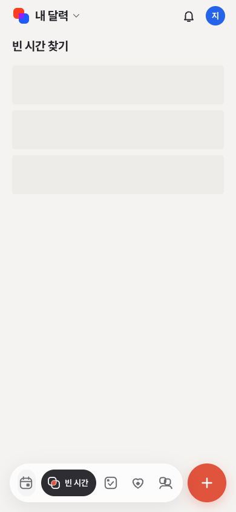
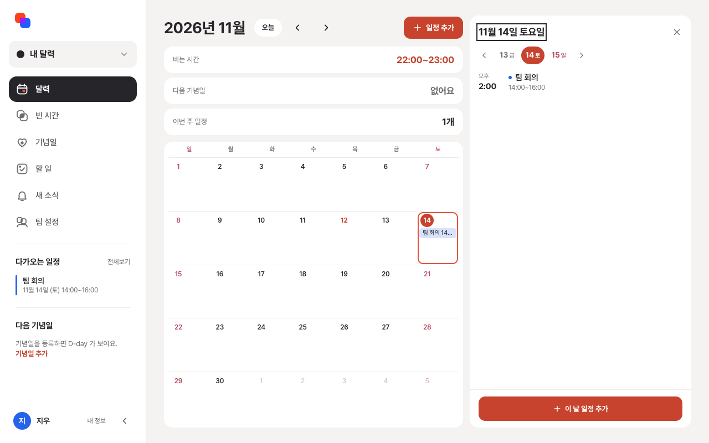
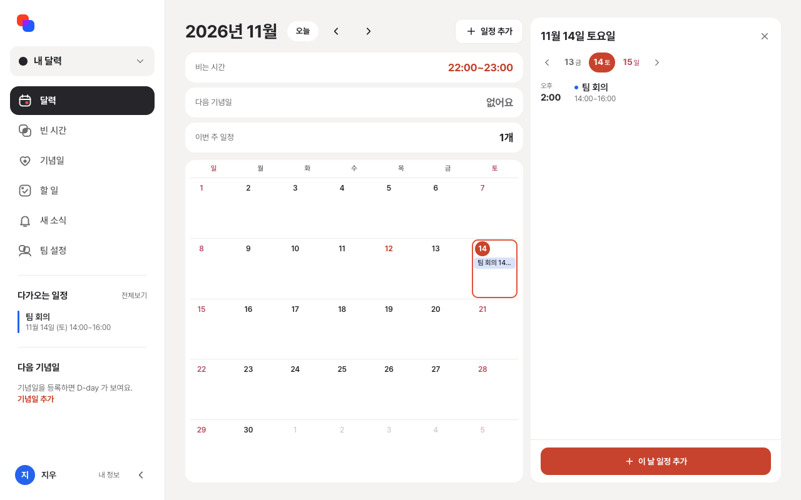
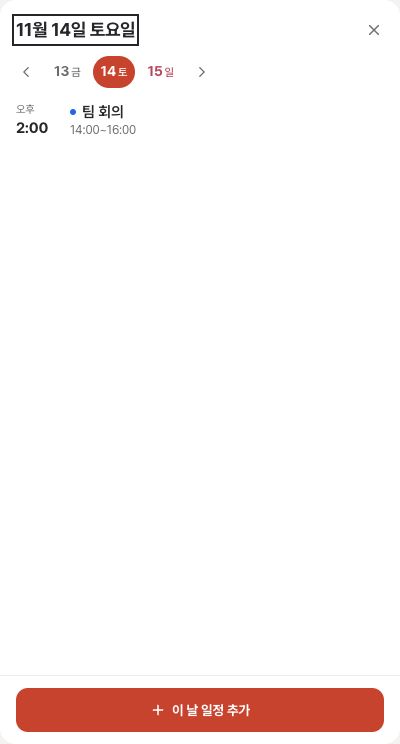
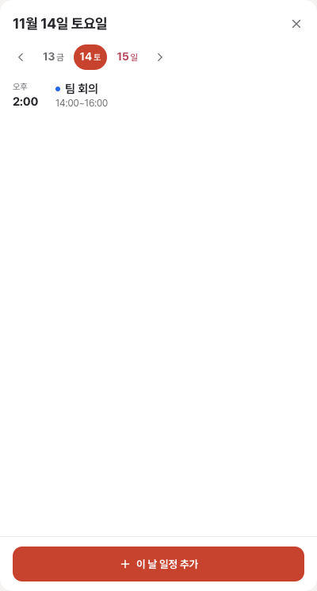

# QA 결과 2026-11-12 (#339 하단 탭 반응 지연, 일 상세 패널 다듬기)

- 브랜치 `fix/339-tab-latency` (develop e74b63a 기준). 결정 D-213, D-214
- 환경: 로컬 운영 빌드(`next build` + `next start`, `API_MOCK=1`, 목 로그인), Chromium(playwright-core), 폰은 390×844 `isMobile` + `hasTouch`. 운영 서버 시간을 흉내 내려고 CDP 로 모든 요청에 지연 200ms
- 측정: 독 칸 `touchstart` 를 0 으로 rAF 마다 확인. 첫 변화 = 칩(aria-current) 이동 또는 본문(main) 변화 중 빠른 것, 주소 = `location.pathname`, 내용 = 본문에 보이는 스켈레톤과 `aria-busy` 가 없어진 때

## 1. 탭 반응 (ms, 수정 전 → 후)
| 바퀴 | 탭 | 첫 변화 | 주소 변경 | 내용 표시 | 이동 RSC 요청 |
|---|---|---|---|---|---|
| 1 | 빈 시간 | 446 → 8 | 446 → 8 | 977 → 957 | 1 → 1 |
| 1 | 할 일 | 436 → 14 | 436 → 16 | 665 → 649 | 1 → 1 |
| 1 | 기념일 | 425 → 12 | 430 → 16 | 647 → 649 | 1 → 1 |
| 1 | 팀 | 439 → 8 | 441 → 16 | 441 → 432 | 1 → 1 |
| 1 | 달력 | 219 → 8 | 220 → 16 | 433 → 233 | 1 → 0 |
| 2 | 빈 시간 | 221 → 20 | 221 → 20 | 748 → 549 | 1 → 0 |
| 2 | 할 일 | 218 → 4 | 219 → 17 | 449 → 234 | 1 → 0 |
| 2 | 기념일 | 219 → 11 | 219 → 14 | 448 → 232 | 1 → 0 |
| 2 | 팀 | 218 → 19 | 218 → 19 | 218 → 19 | 1 → 0 |
| 2 | 달력 | 226 → 15 | 226 → 16 | 450 → 232 | 1 → 0 |

- 두 번째 바퀴 이동 RSC 요청: 5 → 0 (30초 안 재방문은 받아 둔 화면을 쓴다)
- 첫 바퀴 내용 표시는 그대로다: 화면 데이터는 클라이언트 훅이 화면이 뜬 뒤 받는다(이번 범위 밖, 아래 남은 확인)
- 프리페치를 막고(지연 600ms) 누른 경우: 칩 7ms, 주소 640ms. 프리페치 전이어도 칩은 바로 옮긴다
- 느린 망(지연 1500ms)에서 누른 직후 120ms 화면: 제목 + 뼈대 

## 2. 일 상세 패널 (1280)
| 여는 방법 | 수정 전 제목 테두리 | 후 제목 테두리 | 코랄 주 버튼 (전 → 후) |
|---|---|---|---|
| 마우스로 날짜 칸 | 크롬 없음 (사파리는 그림) | 없음 (`data-quiet-focus`) | 일정 추가, 이 날 일정 추가 → 이 날 일정 추가 |
| 주소 `/calendar?date=…-14&day=1` | **있음** (solid 2px) | 없음 | 같음 |
| 키보드 (날짜 칸 포커스 → Enter) | 있음 | 있음 (solid 2px) | 같음 |
| 패널 닫힘 | | | 일정 추가 1개 (그대로 코랄) |

- 코랄 판정: 보이는 `a`, `button` 의 계산된 배경이 `--btn`(200,67,45) 또는 `--pri`(224,83,61). 패널 머리 ‹ 13 [14] 15 › 의 선택 날짜(`aria-pressed`, `--sel-fill`)는 선택 상태라 뺐다
- 포커스는 여전히 제목으로 간다(`document.activeElement` = 제목)

| 수정 전 (주소로 열기) | 수정 후 (주소로 열기) |
|---|---|
|  |  |
|  |  |

| 수정 후 마우스 | 수정 후 키보드 |
|---|---|
|  |  |

## 3. 회귀
| 항목 | 결과 |
|---|---|
| 가로 넘침 390, 1280 (`/calendar` `/upcoming` `/free` `/todos` `/anniversaries` `/news` `/team` `/me`) | 16 화면 모두 scrollWidth ≤ clientWidth |
| 비로그인 `/free` | `/login?next=%2Ffree` |
| `/auth/landing` | 200 |
| 웹 `pnpm test` | 57 파일 684개 통과 (새 `lib/__tests__/input-modality.test.ts`, `navTab`, DayPanel 포커스 테두리 2줄, 독 onNavigate) |
| `lint`, `tsc`, `knip`, `build` | 통과 |

## 4. 리전 측정 (서울에서 curl, 10회 중앙값)
| 요청 | 연결 RTT | 연결 뒤 첫 바이트 |
|---|---|---|
| `whenwemeet.day/api/groups` (쿠키 없음: 함수가 API 를 부르지 않고 401) | 10 | 118 |
| `whenwemeet.day/api/health` (함수 sin1 → API) | 10 | 143 |
| `api.whenwemeet.day/v1/health` (서울 → Railway 엣지 hnd1 → API) | 40 | 156 |

- Railway: `api`, `MySQL` 모두 `asia-southeast1`(싱가포르). Vercel 응답 `x-vercel-id: icn1::sin1`
- 서울 ↔ sin1 함수 왕복이 약 110ms, sin1 → API 추가는 약 25ms. 판단은 D-213: sin1 유지(icn1 로 옮기면 API 호출마다 서울 ↔ 싱가포르를 한 번 더 건넌다)

## 남은 확인 (배포 뒤)
- 운영 배포 뒤 폰에서 같은 표 재측정 (탭 첫 변화, 주소, 내용, 반복 이동 RSC 요청)
- 첫 방문 탭의 내용 표시는 데이터 요청(서울 → sin1 → API) 을 기다린다. 탭 사이 데이터 유지가 필요하면 클라이언트 캐시를 설계에서 따로 다룬다
