# QA 결과 2026-11-12 (#343 일정 색 + 핑크)

- 브랜치 `feat/343-event-color` (develop cc11c73 기준). 결정 D-215
- 환경: 로컬 API(`nest build` → `node dist/main.js`, NODE_ENV=development, 새 DB `wwm_343_dev` 에 마이그레이션 전부) + 웹 운영 빌드(`next build` + `next start`, `API_URL` 로 로컬 API). 로그인은 `dev-login` 토큰을 `wwm_session` 쿠키로. Chromium(playwright-core), 폰은 390×844 `isMobile` + `hasTouch`, PC 1280×900
- 시드: 팀 "우리집"(지우 = 나, 하늘, 민지), 장보기(나, 하늘), 가족 저녁(모두), 요가(색 `#5B6CF4` = 브라운), 제주 여행(종일 11/20~22, 핑크), 주간 회의(매주 목 20:00, 나, 하늘)
- 새 소식 수는 다른 멤버(하늘)의 `GET /groups/:id/news?v=2` 항목 수로 셌다

## 1. 실제 흐름 (390 라이트)
| 단계 | 결과 |
|---|---|
| 새 일정 폼 | 색 줄 기본 "자동"(aria-checked). 자동에서 ← 를 누르면 핑크로 돈다(포커스, 선택 같이) |
| 핑크로 저장 | 본문 `color: "#F279B5"`, 응답과 목록 `#F279B5`. 새 소식 +1 (CREATED) |
| 수정 화면 | 핑크가 고른 칸으로 열림 |
| 자동으로 바꿔 저장 | 본문 `color: null`, 저장 값 null, **새 소식 +0** |
| 반복 일정을 `scope=this` 로 열기 | 색 칸 9개 모두 disabled, 안내 "반복 일정의 색은 이후 모두에서 바꿀 수 있어요" |
| 반복 회차(11/19)에서 틸을 골라 저장 | 범위 시트의 "이 일정만" 막힘("반복, 참여자, 색을 바꾸면 이 일정만 고칠 수 없어요") |
| "이후 모두" | 본문 `color: "#F2C94C"`(틸 키). 11/12 null, 11/19 와 11/26 틸 (새 원본), **새 소식 +0** |
| 팀 설정 내 색 | 팔레트 8개(블루 ~ 핑크). 핑크를 누르면 "내 색을 바꿨어요", API `me.color = #F279B5` |

| 새 일정 핑크 | 이 일정만 | 범위 시트 | 내 색 핑크 |
|---|---|---|---|
| 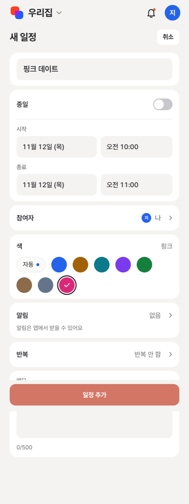 | 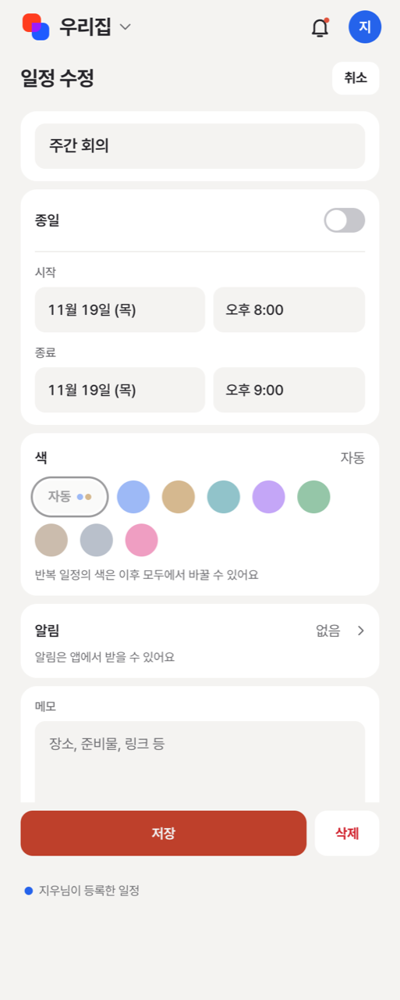 | 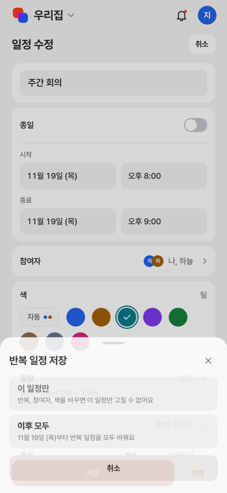 | 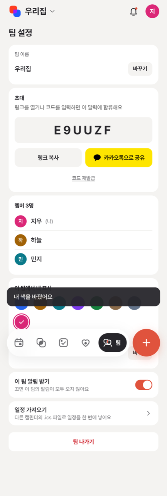 |

## 2. 화면 (390, 1280 x 라이트, 다크)
달력 월, 일 보기(폰) / 일 상세 패널(PC), 다가오는 일정 16장. 모두 가로 넘침 없음(scrollWidth - clientWidth = 0). 원본은 작업 PC scratchpad `shots-343/`, 여기에는 일부만.

- 일정 색을 고른 일정(핑크 데이트, 제주 여행, 요가, 주간 회의 11/19 이후)은 칩 면, 막대, 점이 그 색 하나. 자동 일정(장보기, 가족 저녁)은 그대로 참여자 색 나눔과 점 묶음
- 내 색을 핑크로 바꾼 뒤라 자동 일정의 첫 참여자 색도 핑크로 보인다(정상)
- 계산된 변수: 라이트 `--m8 #db2777`, `--holiday #b4475c`, `--pri #e0533d`, `--on-member #fff` / 다크 `--m8 #f472b6`, `--holiday #d3949e`, `--pri #ff8670`, `--on-member #121214`
- 주말과 코랄에서 갈리는지: 11/20~22 핑크 막대가 토, 일 숫자(주말색) 바로 아래에 있어도 막대는 선명한 분홍, 숫자는 채도 낮은 장미라 갈린다. 코랄 오늘 원(12일)과도 색상각이 다르다

| 월 390 라이트 | 월 390 다크 | 일 보기 390 라이트 | 다가오는 일정 390 라이트 |
|---|---|---|---|
| 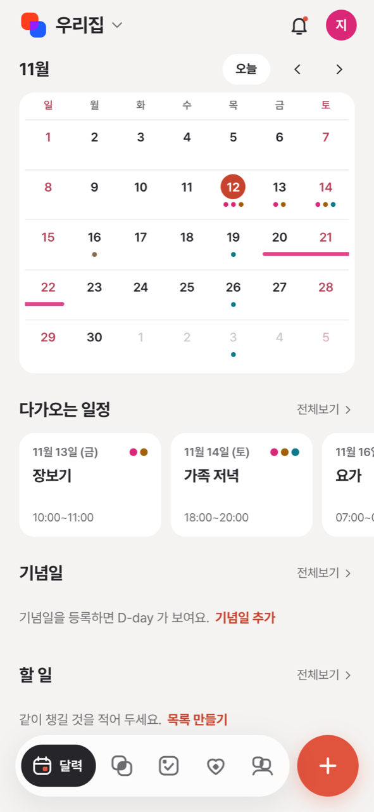 | 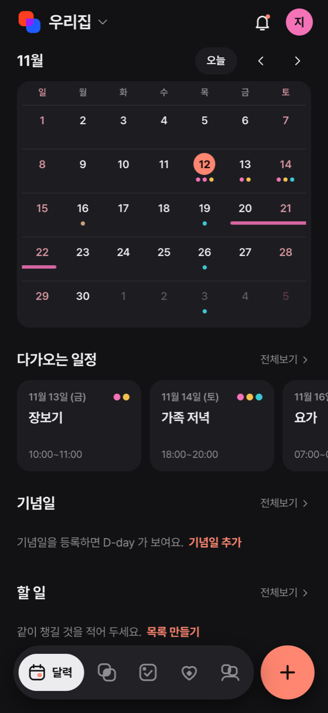 | 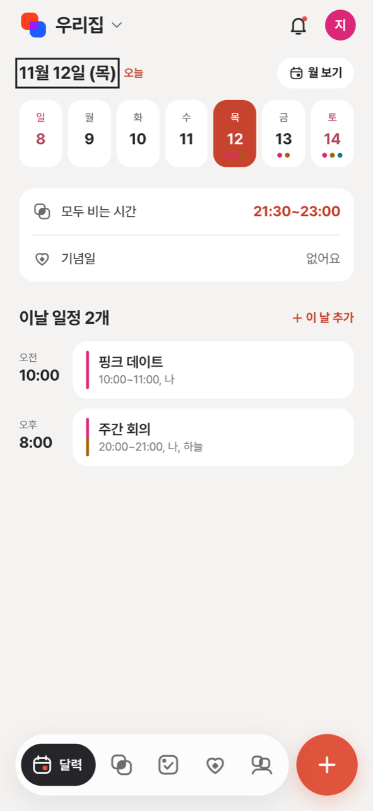 | 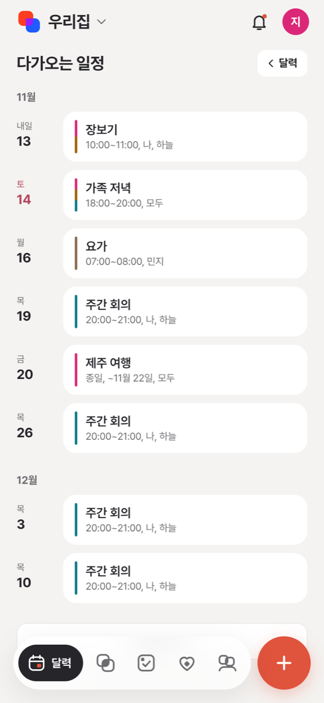 |

| 월 1280 라이트 | 월 1280 다크 |
|---|---|
| 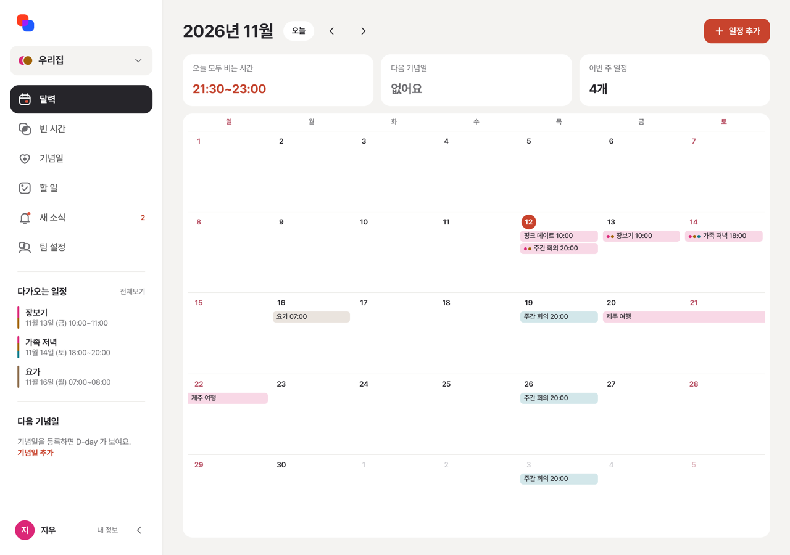 | 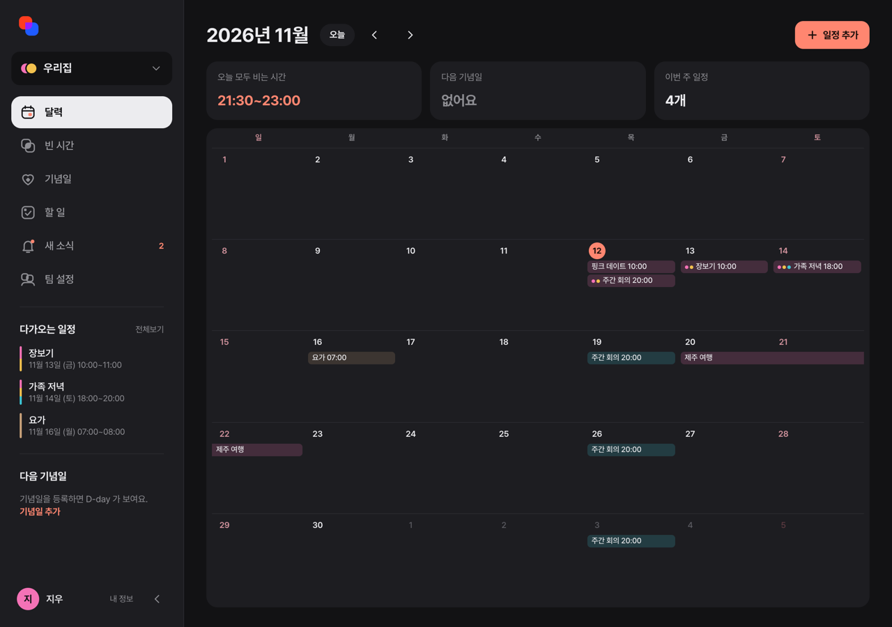 |

| 일 상세 패널 1280 다크 (11/20) | 다가오는 일정 1280 다크 |
|---|---|
| 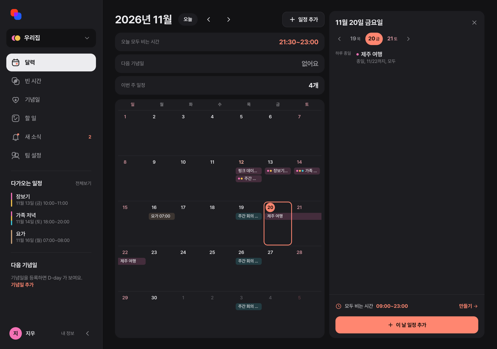 | 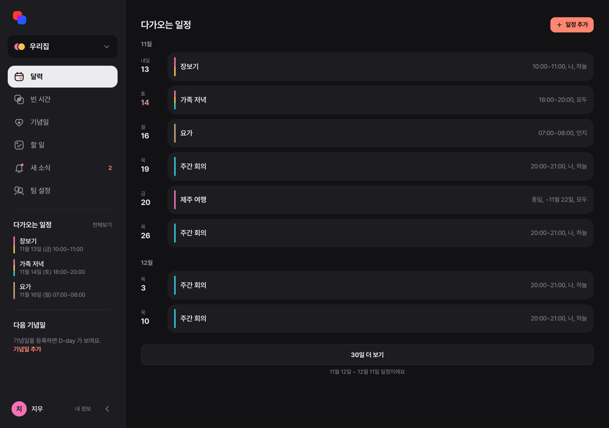 |

## 3. 자동 검사
| 항목 | 결과 |
|---|---|
| API `pnpm test` (wwm_343_test) | 81 파일 1,162개 통과 (새 `test/event-color.e2e-spec.ts` 8개, 서비스 단위, 배정 순서, 공유 미리보기, ICS 색 null) |
| API `lint`, `build` | 통과 |
| 웹 `pnpm test` | 59 파일 701개 통과 (새 `colors.test.ts`, `EventColorPicker.test.tsx`, 참여자 색, 칸 점, 위젯 스냅샷, 목) |
| 웹 `lint`, `tsc`, `build`, 루트 `knip` | 통과 |

## 4. 확인하지 못한 것
- 앱 위젯: 웹은 일정 항목에 `c` 를 싣지만 지금 셸(`apps/mobile`)은 읽지 않는다. 셸이 팀 색 7 이상을 받으면 스냅샷을 버리므로 팀 색은 0~6(핑크는 슬레이트)으로 보낸다. 위젯에 일정 색을 그리려면 셸 수정과 앱 출시가 필요하다
- 공유 받는 화면(`/join/e/<token>`)의 색 점은 단위 수준(미리보기 API e2e)만 확인. 일정 카드 이미지(OG)는 원래 일정 색을 그리지 않아 바꾸지 않았다
