# QA 결과 2026-11-13 (#189 약속 투표)

- 브랜치 `feat/189-polls` (자동 테스트는 develop 1bf2d34 위 최종 커밋, 브라우저 흐름은 #305 리베이스 직전 e4d8b0c 위 빌드. #305 와 겹친 곳은 사이드바 테스트 목과 목 테스트뿐이다), 로컬 MySQL 3307 의 전용 DB `wwm_189_dev`, `wwm_189_test` (둘 다 새로 만들어 마이그레이션 전체를 처음부터 적용)
- 결정: D-234 ~ D-241. API 는 `node dist/main`(PORT 4189, `PUSH_ENABLED=1`, 가짜 Expo 서버 4390), 웹은 `next build` + `next start`(3189, 실제 API). 사용자 3명(민지, 지훈, 서연)은 dev-login, 팀 "우리 셋", 기기 3대 등록. playwright-core Chromium, Asia/Seoul

## 자동 테스트
| 항목 | 결과 |
|------|------|
| API 전체 (`vitest run`, unit + e2e, 새로 마이그레이션한 `wwm_189_test`) | 94 파일, 1321개 통과 (unit 68 파일 1009개, e2e 26 파일 312개). 마이그레이션 24개를 빈 DB 에 처음부터 적용, `migrate diff` 로 스키마와 차이 없음 확인 |
| `polls.e2e-spec.ts` (12, 실 DB) | 401/403/404, 만들기 검증(후보 수, 지난 후보, 중복, 마감, 시간대 없는 ISO, 비멤버 대상, 개인 팀)과 종일 후보, 진행 중 10개 상한, 표 전체 교체와 대상 밖 403 NOT_PARTICIPANT, 지난 후보(새로 켜기 400, 켜 둔 표 유지, 정하기 400), 정하기 트랜잭션(일정 값, 새 소식 POLL_CLOSED 한 줄, 안 읽은 수, CHANGE 없이 PC 알림, 닫힌 뒤 409 3종, 일정 삭제 시 eventId null), **동시 정하기 3개 → 201 하나, 일정 하나**, BUSY_NOW(다른 팀 일정), 마감 틱(한 번만, 15분 늦은 것은 SKIPPED), 취소(기록 삭제, 열림 알림 SKIPPED), 나가기와 탈퇴, `poll` 알림 끄기, 30일 상한 |
| API 단위 | `poll-rules.spec`(9), `polls.service.spec`(13), `poll-planner.spec`(2), 푸시 문구, 펼치기 POLL 4, 새 소식 숨김, 안 읽은 수, `pollEventLogIds` |
| 웹 전체 (`vitest run`) | 75 파일, 896개 통과 (새 `lib/__tests__/poll.test.ts`, `PollScreen.test.tsx`, `PollCreateSheet.test.tsx`, 사이드바 한 줄, 새 소식 문구, 목 투표 흐름, 알림 설정 7줄) |
| 빌드, 린트, knip | api `build`, `lint` 경고 0. web `tsc`, `lint`, `next build`. 루트 `knip` 통과 |

## 흐름 (실제 API) 
| # | 확인 | 결과 |
|---|------|------|
| 1 | 팀 빈 시간 결과에 "투표로 정하기", 개인 팀에는 없음 | 통과 |
| 2 | 선택 모드: 체크 1개면 "후보를 1개 더 골라 주세요", 3개면 "후보 3개로 투표 만들기" | 통과 |
| 3 | 시트: 구간마다 2시간 후보 + 시작 시각 피커, 마감 "내일" = 내일 이맘때(30분 올림), 대상 "모두" | 통과 |
| 4 | 만들기 → `/polls/<코드>`, API 값(제목, 후보 3, 마감, 모두), 지훈 새 소식 "민지님이 '저녁 약속' 투표를 열었어요" | 통과 |
| 5 | 열림 알림: 지훈, 서연 기기에만(민지 제외), 본문 "후보 3개, 마감 11월 14일 (토) 오후 2:30", 경로 `/polls/<코드>?team=` | 통과 |
| 6 | 지훈 가능 켜기, 켜기, 끄기 → 남은 표 둘째 후보 하나. 서연 둘. 후보별 "지훈+서연", "서연" | 통과 |
| 7 | 폰 홈 "정하는 중" 카드 "3명 중 2명 답했어요, 11월 14일 (토) 오후 2:30까지", 넓은 화면 사이드바 한 줄 | 통과 |
| 8 | 지훈(연 사람 아님) 정하기 → 확인 창 "11월 14일 (토) 오전 9:00~11:00에 '저녁 약속' 일정이 생기고 투표는 끝나요" → 일정 상세로 | 통과 |
| 9 | 일정 값: 시각 = 후보, 제목, 참여자 모두 3명, 알림 NONE, 등록자 지훈. 투표 CLOSED | 통과 |
| 10 | 민지 새 소식 맨 위 POLL_CLOSED, "일정을 추가했어요" 줄 없음. 서연 안 읽은 수 3(장보기, 열림, 정함) = 목록 줄 수 | 통과 |
| 11 | 정함 알림: 민지, 서연(지훈 제외) "지훈님이 '저녁 약속' 시간을 정했어요" / "11월 14일 (토) 오전 9:00" → `/events/<코드>` | 통과 |
| 12 | 마감 45초 투표: 마감 뒤 표 409 "투표가 끝났어요", 틱이 연 사람(지훈)에게 "'주말 등산' 투표가 끝났어요" 1건, 다음 틱에 다시 안 보냄 | 통과 |
| 13 | 마감 지난 투표 화면: 가능 버튼 없음, "투표가 끝났어요. 후보를 하나 골라 정해 주세요" | 통과 |
| 14 | 내 정보 > 알림 "약속 투표" 켬, 없는 코드 `/polls/zzzzzzzz` → 팀 화면 404 | 통과 |
| 15 | 콘솔 오류 없음 | 통과 |

## 화면
| 화면 | 라이트 | 다크 |
|------|------|------|
| 빈 시간 390 | 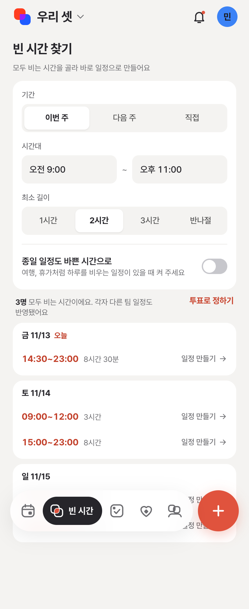 | |
| 선택 모드 390, 1280 | 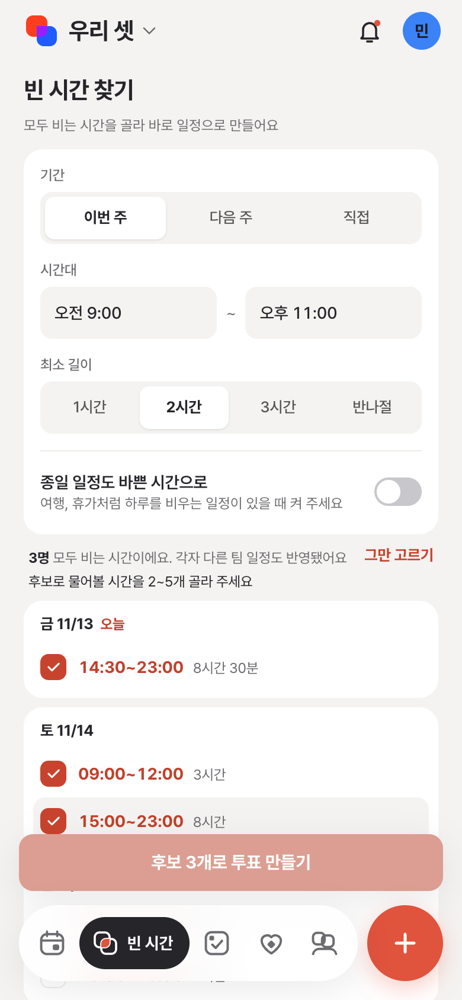 | 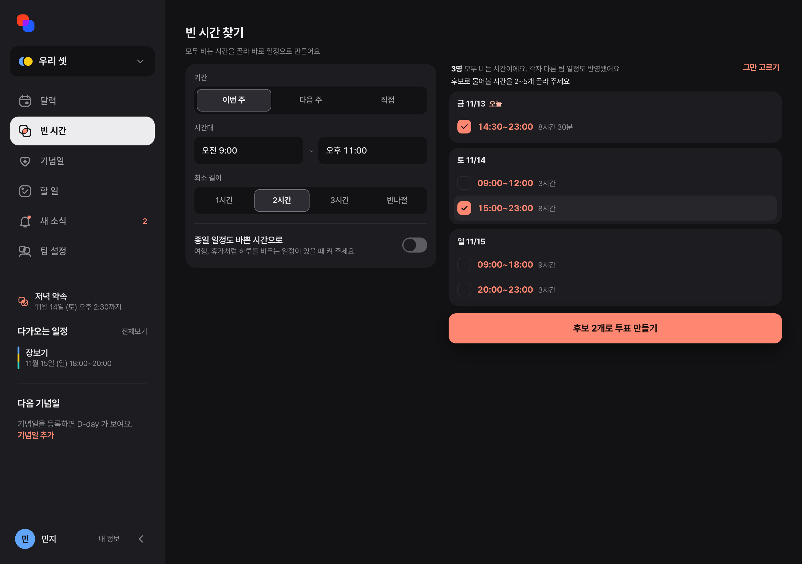 |
| 만들기 시트 390, 1280 | 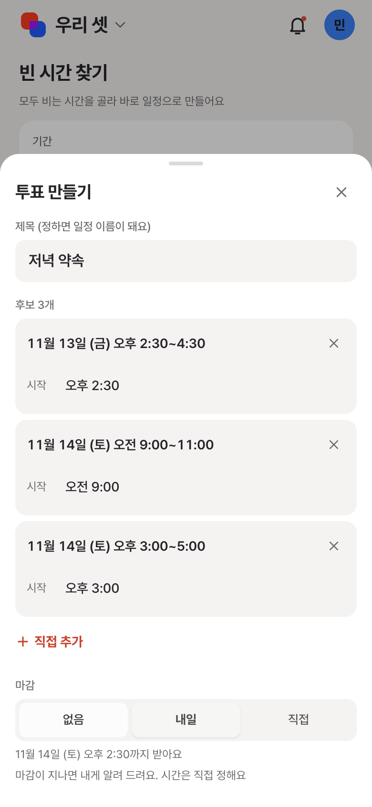 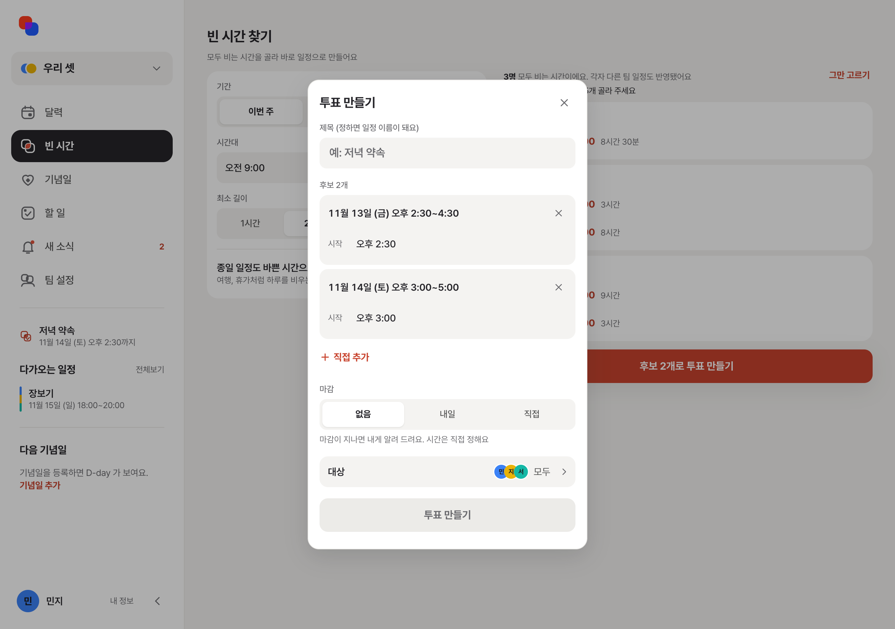 | |
| 투표 화면 390, 1280 | 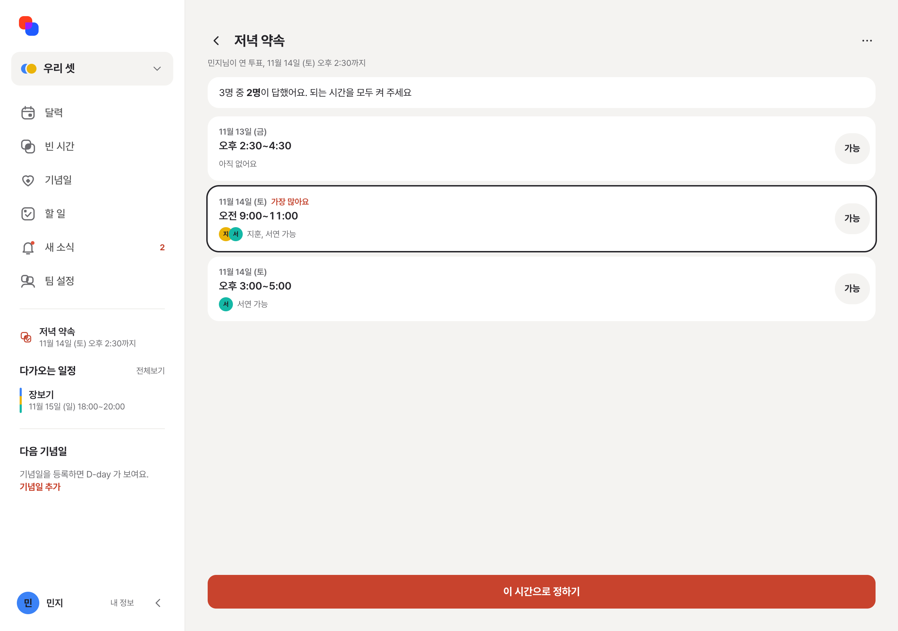 | 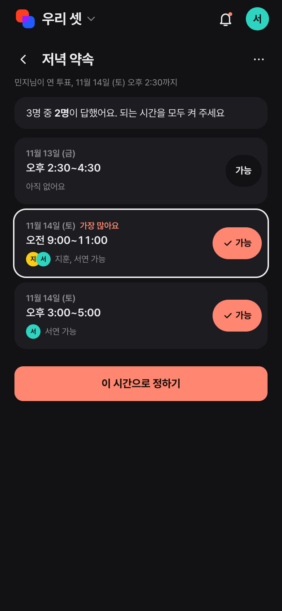 |
| 홈 정하는 중 390 | 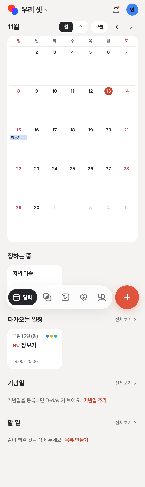 | 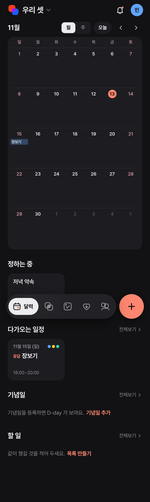 |
| 사이드바 한 줄 1280 | | 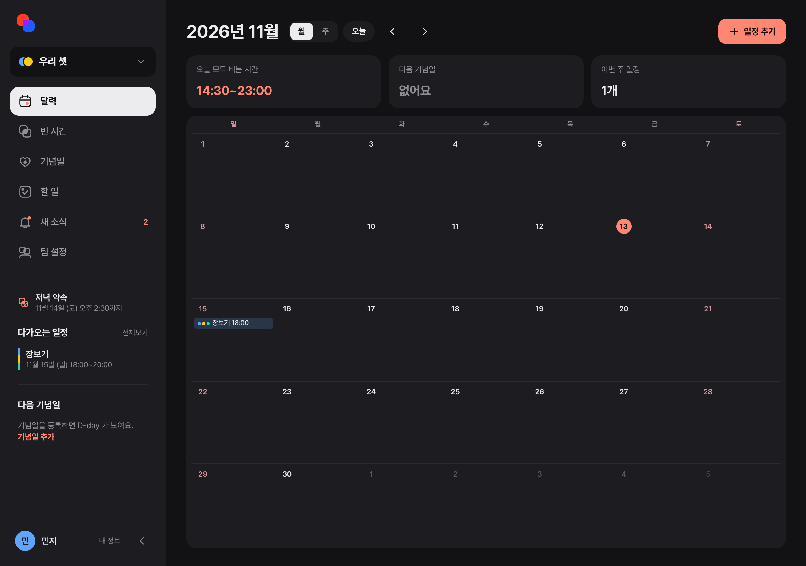 |
| 정하기 확인, 정한 뒤 일정 | 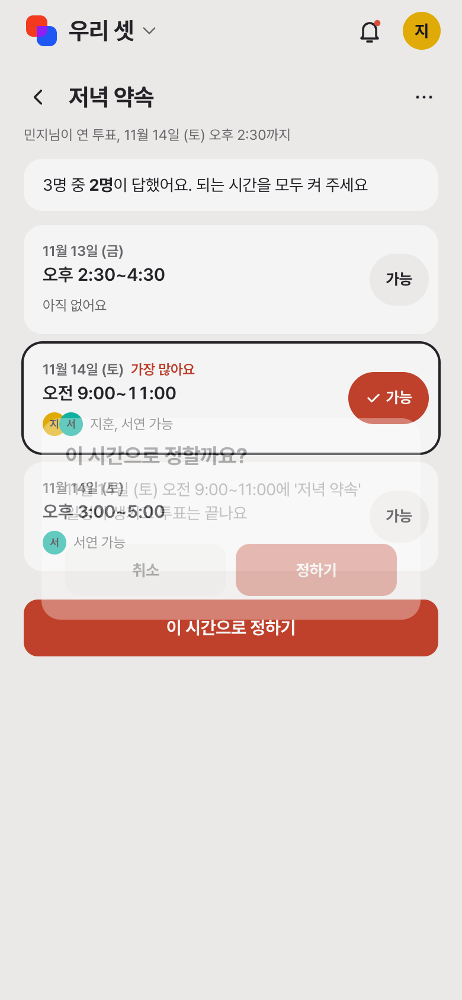 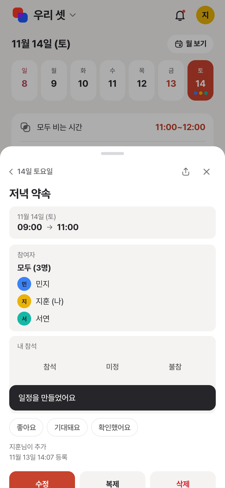 | |
| 정한 투표 390, 1280 | 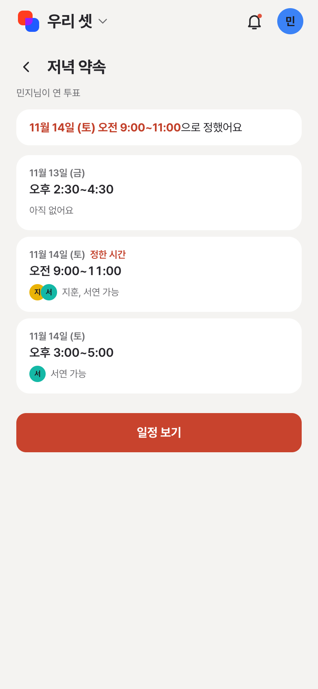 | 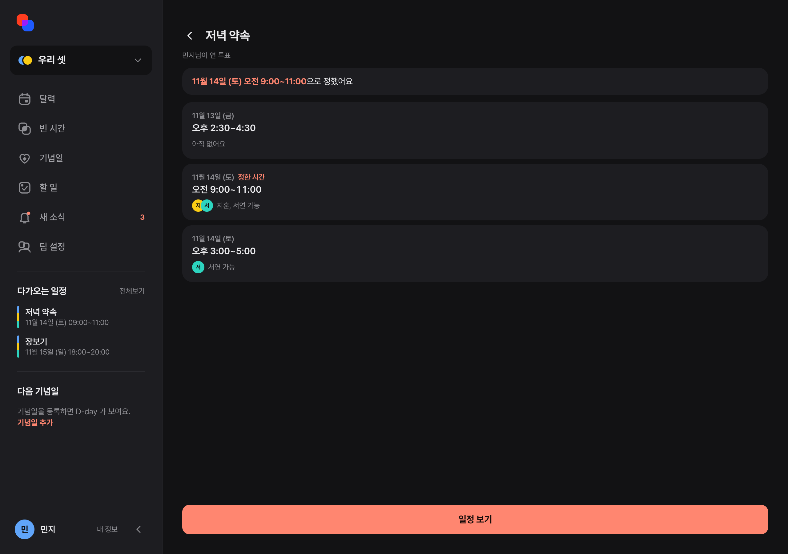 |
| 새 소식 390 | 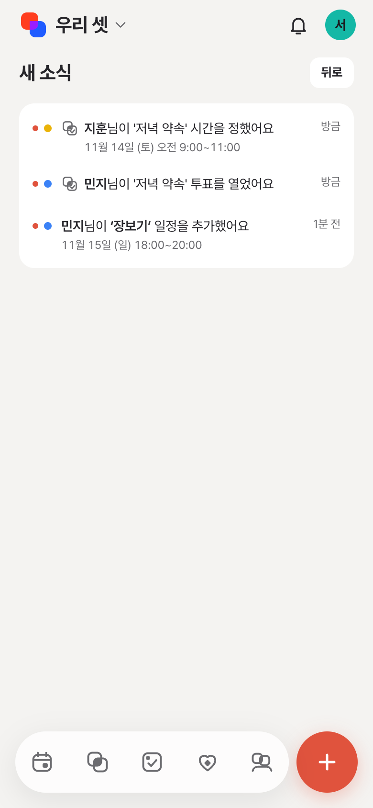 | |
| 마감 지난 투표 | 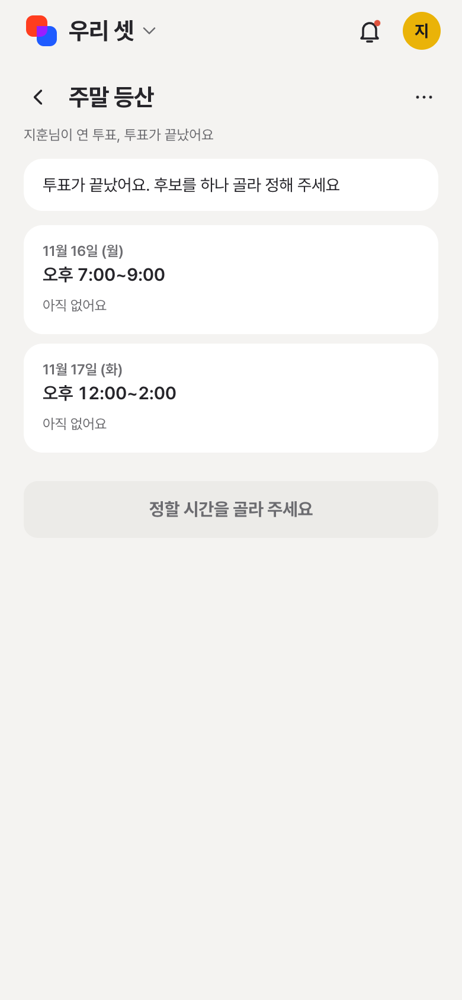 | |
| 알림 설정 | 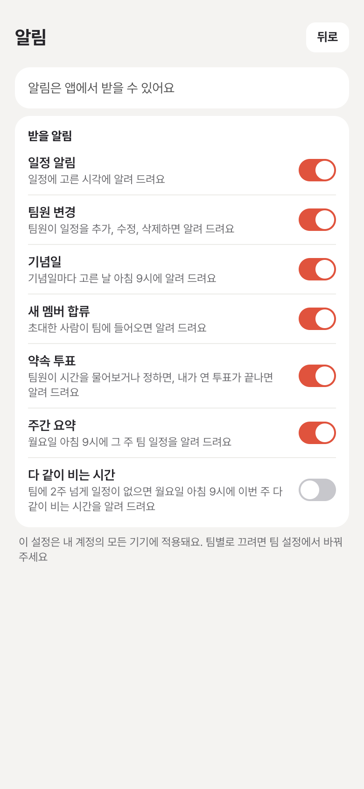 | |

## 확인 못 한 것
- 실제 기기 푸시 수신(가짜 Expo 서버로 보낸 메시지만 확인)
- 폴드(600~1023) 폭, 사이드바 접힘 상태의 화면 캡처, 가로 넘침 전수 검사
- 목 모드(`API_MOCK=1`)는 단위 테스트(목 핸들러 흐름)만, 브라우저로는 돌려 보지 않았다
